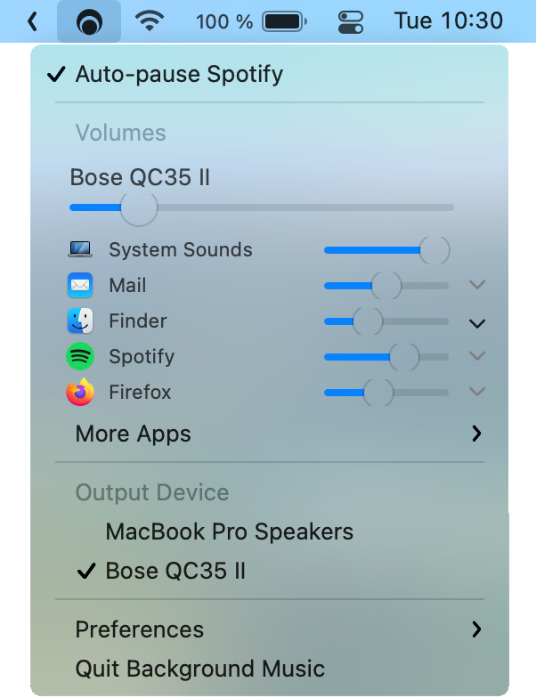

# Background Music


Краткое описание: Background Music - утилита для macOS, которая добавляет управление громкостью отдельных приложений, автопаузу музыкального проигрывателя и запись системного звука. В этой версии переведены ключевые пункты меню, предупреждения, подсказки и скрипты установки.



## ✨ Возможности

- Автоматическая пауза музыки, когда другое приложение начинает воспроизводить звук.
- Возобновление музыки после остановки второго источника звука.
- Отдельная регулировка громкости приложений.
- Усиление тихих приложений выше их обычного максимума.
- Запись системного звука через виртуальное аудиоустройство.
- Быстрая установка через готовый скрипт.

## 🚀 Быстрый старт

```bash
git clone https://github.com/QuestGuideRF/BackgroundMusic.git
cd BackgroundMusic
/bin/bash build_and_install.sh
```

Скрипт устанавливает приложение, драйвер и вспомогательный сервис. В конце установки он перезапускает `coreaudiod`, поэтому перед запуском лучше остановить воспроизведение звука.

## 📦 Установка зависимостей

Для сборки из исходников нужен macOS 10.13 или новее и Xcode 10 или новее. Проект собирается через Xcode/xcodebuild и не использует пакетный менеджер для зависимостей.

Проверка доступности Xcode:

```bash
xcodebuild -version
```

## 📁 Структура проекта

```text
BackgroundMusic/
├─ BGMApp/                      # приложение, XPC helper и UI-тесты
├─ BGMDriver/                   # виртуальный аудиодрайвер
├─ SharedSource/                # общий код C++/Core Audio
├─ Images/                      # изображения для README и иконок
├─ pkg/                         # файлы упаковки
├─ build_and_install.sh         # сборка и установка
├─ uninstall.sh                 # удаление
└─ package.sh                   # сборка пакета
```

## 🛠 Использование

После установки запустите `Applications > Background Music.app`. Приложение появится в строке меню macOS и временно назначит виртуальное устройство Background Music устройством вывода по умолчанию. При выходе приложение возвращает прежнее устройство.

Удаление:

```bash
cd /Applications/Background\ Music.app/Contents/Resources/
bash uninstall.sh
```

## ⚙️ Конфигурация

- Основное меню находится в `BGMApp/BGMApp/Base.lproj/MainMenu.xib`.
- Разрешения macOS описаны в `BGMApp/BGMApp/Info.plist`.
- Настройки автопаузы и меню приложения находятся в `BGMApp/BGMApp/Preferences/`.
- Скрипт установки настраивается параметрами `build_and_install.sh`; справка доступна через:

```bash
/bin/bash build_and_install.sh --help
```

## 🧪 Тестирование

Отдельная универсальная команда тестов в README проекта не указана. UI-тесты находятся в `BGMApp/BGMAppTests/UITests/` и запускаются через Xcode. Для проверки сборки из терминала используйте основной сценарий:

```bash
/bin/bash build_and_install.sh
```

## 🧰 Технологии

- Objective-C и Objective-C++.
- C++ и Core Audio.
- Xcode, xcodebuild и shell-скрипты.
- macOS audio driver и XPC helper.
- pkg-упаковка.

## 📝 Лицензия

Условия лицензирования и уведомления для Apple Sample Code опубликованы в [исходном репозитории Background Music](https://github.com/kyleneideck/BackgroundMusic).

## Ручная сборка и установка

Запускайте команды из корня проекта в macOS. Требуются Xcode и права администратора для установки драйвера и помощника.

~~~bash
sudo xcodebuild -project BGMDriver/BGMDriver.xcodeproj \
  -target "PublicUtility" RUN_CLANG_STATIC_ANALYZER=0 clean build

sudo xcodebuild -project BGMDriver/BGMDriver.xcodeproj \
  -target "Background Music Device" RUN_CLANG_STATIC_ANALYZER=0 DSTROOT=/ clean install

sudo xcodebuild -project BGMApp/BGMApp.xcodeproj \
  -target BGMXPCHelper RUN_CLANG_STATIC_ANALYZER=0 DSTROOT=/ \
  INSTALL_PATH="$(BGMApp/BGMXPCHelper/safe_install_dir.sh)" clean install

sudo xcodebuild -project BGMApp/BGMApp.xcodeproj \
  -target "Background Music" RUN_CLANG_STATIC_ANALYZER=0 DSTROOT=/ clean install
~~~

Драйвер устанавливается в `/Library/Audio/Plug-Ins/HAL`, приложение — в `/Applications`. Приостановите воспроизведение, перезапустите `coreaudiod` командой `sudo killall coreaudiod` и откройте Background Music. Если системная служба не перезапустилась, используйте `sudo launchctl kickstart -kp system/com.apple.audio.coreaudiod`.

## Ручное удаление

1. Закройте приложение. Удалите `Background Music.app` из `/Applications` и `Background Music Device.driver` из `/Library/Audio/Plug-Ins/HAL`.
2. Перезапустите `coreaudiod` и выберите обычное устройство вывода в системных настройках звука. Если виртуальное устройство осталось в списке, проверьте содержимое HAL и перезагрузите Mac.
3. Для удаления помощника проверьте `/usr/local/libexec` и `/Library/Application Support/Background Music`. Если служба зарегистрирована, выгрузите `/Library/LaunchDaemons/com.bearisdriving.BGM.XPCHelper.plist` через `sudo launchctl bootout system <путь>`. Для старых версий OS X используется `launchctl unload`. Затем удалите plist, `BGMXPCHelper.xpc` и служебные записи пользователя и группы `_BGMXPCHelper`, если они присутствуют.

## Разработка звукового тракта

- **BGMDriver** публикует виртуальное устройство через Core Audio HAL. Точки входа HAL находятся в `BGM_PlugInInterface.cpp`. `BGM_Device` обслуживает потоки, кольцевой буфер, громкость отдельных приложений и определение источника аудио.
- **BGMApp** переключает устройство вывода на виртуальное и через `BGMPlayThrough` передаёт поток на физический выход. Виртуальный вход также можно выбрать в программе записи. `BGMXPCHelper` передаёт XPC-сообщения между приложением и драйвером, в частности при запуске ввода-вывода, а общий код хранится в `SharedSource`.
- Обработчики реального времени должны завершаться за предсказуемое время. В них нельзя выделять память и ждать обычных блокировок. Для передачи работы между потоками используется `BGM_TaskQueue`.
- Для отладки драйвера соберите цели `PublicUtility` и драйвера в конфигурации Debug. Скрипт `BGMDriver/BGMDriver/quick_install.sh` устанавливает локальную сборку. HALLab помогает просматривать свойства устройств Core Audio. Старые способы отладки с выгрузкой системной службы до появления SIP не подходят для современных версий macOS.
- Сценарий `package.sh` использует файлы из `pkg/` для создания установочного пакета.

### Сообщения об ошибках и изменения

Укажите версию, macOS и последовательность действий, приводящую к ошибке. Если сбой произошёл в установщике, приложите `build_and_install.log` из каталога скрипта. Журнал приложения доступен в Console.app по запросу `BGM` или `Background Music`. Для подробного журнала можно собрать отладочную версию через `./build_and_install.sh -d`.

Код приложения удобно изучать с `BGMApp/BGMApp/BGMAppDelegate.mm`, а входы драйвера HAL описаны выше. При существенной правке файла укажите авторство изменений в уведомлении об авторских правах. Если выбрали другой способ указания авторства, отметьте это в запросе на слияние.

### Идеи дальнейшей разработки

Кандидаты из списка задач — горячие клавиши и многоканальный вывод, восстановление физического выхода после отключения устройства или сбоя приложения, сохранение громкости между сеансами, дополнительные проигрыватели и отдельная команда записи звука. Для драйвера выделены интеграционные и нагрузочные тесты, работа с AddressSanitizer, сборка на чувствительной к регистру файловой системе, изоляция компонентов и диагностика сбоев. Обсуждались также переработка `BGM_Device.cpp`, восстановление playthrough, запуск одного экземпляра приложения и связь вспомогательных процессов проигрывателей с их идентификаторами.

Подпись относится к текущей версии проекта.

---

Автор: legenda  
Telegram: [@LEGENDA_SD](https://t.me/LEGENDA_SD)
